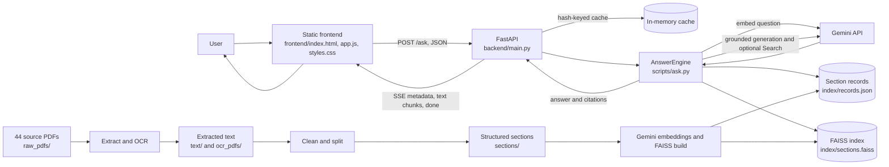

# Nithi Sahaya Architecture

## Overview

Nithi Sahaya is a Sri Lankan labour-law information pilot. It uses retrieval-augmented generation (RAG): the backend finds relevant passages in the project's indexed legal documents and asks Gemini to write a plain-language response with references. When local retrieval finds no useful passage, Gemini can provide a clearly labelled alternative answer, using Google Search grounding when enabled.

The browser application is a static site. The Python API handles retrieval, calls to Gemini, citation validation, caching, and response formatting. Legal PDFs and derived search data are stored in the repository as files rather than in a database.

## System diagram

## Runtime request flow

1. The user submits a question and selected language in the static frontend. The browser sends JSON to `POST /ask` and does not store chat history or feedback in browser storage.
2. FastAPI validates the request, applies an in-process rate limit, and checks an in-process cache keyed by a hash of the normalized question, language, and retrieval count.
3. On a cache miss, the API runs `AnswerEngine.ask` in a worker thread. The engine handles emergency and brief small-talk messages directly, then handles labour-law questions through retrieval and generation.
4. For a labour-law question, the engine embeds the query with the configured Gemini embedding model. It combines FAISS semantic search with BM25-style lexical scores, reranks candidates, and uses the best passages as context.
5. Gemini writes a structured answer. Google Search grounding is enabled by default and can supply current web references. For a low-confidence local match, the response is labelled as an alternative Gemini answer and is explicitly identified as not verified against the local knowledge base.
6. The engine validates generated source identifiers and URLs before rendering citations. Local section references and web references are returned separately.
7. FastAPI returns Server-Sent Events (SSE): one metadata event, answer text chunks, then a completion marker. Generation completes before these chunks are sent; this is a chunked response format, not token-by-token model streaming.
8. The frontend renders the answer, inline citation controls, expandable references, and a retry control after errors.

## Components and responsibilities

| Component | Responsibility |
| --- | --- |
| `frontend/` | Static, dependency-free chat and contact pages. Sends questions to the API and renders answers and references. |
| `backend/main.py` | FastAPI endpoints, request validation, CORS, rate limiting, in-memory cache, safe error handling, and SSE response formatting. |
| `scripts/ask.py` | Scope and emergency handling, query expansion, semantic and lexical retrieval, Gemini prompts, optional Google Search grounding, citation validation, and final answer assembly. |
| `raw_pdfs/` | The 44 original PDF documents used as the current corpus. |
| `text/`, `ocr_pdfs/` | Extracted text and OCR-assisted material used during corpus preparation. |
| `sections/` | Structured legal records split by Act or instrument; these are the retrieval corpus before indexing. |
| `index/` | FAISS vectors and the corresponding record metadata loaded by the runtime answer engine. |
| `audit/` | Corpus inventories, quality checks, source-currentness notes, and review artifacts. |
| `scripts/` | Offline extraction, OCR support, section processing, indexing, audits, and evaluation utilities. |
| `eval/` | Evaluation questions, reference answers, and evaluation artifacts. |

## Corpus and index build

The offline data path starts with the original PDFs in `raw_pdfs/`. Extraction and OCR workflows produce text, which is cleaned and split into structured section records under `sections/`. `scripts/build_index.py` embeds each record's Act name, section number, heading, and text with the configured Gemini embedding model. It writes the FAISS index, record metadata, and resumable embedding checkpoints into `index/`.

The runtime expects `index/sections.faiss` and `index/records.json`. Rebuild the index after changing section content so the vectors and records stay aligned. The checked-in index is a local generated artifact; the source PDFs remain the underlying corpus.

## Configuration and external dependencies

Configuration is read from environment variables and `.env` at the repository root. Key settings include:

- `GEMINI_API_KEY`: Gemini API access. Keep it on the backend; never expose it in frontend files.
- `CHAT_MODEL` and `EMBED_MODEL`: generation and embedding models.
- `GEMINI_GOOGLE_SEARCH`: enables Google Search grounding; enabled by default.
- `MIN_RETRIEVAL_SCORE` and `RETRIEVAL_TOP_K`: retrieval threshold and number of candidates.
- `CORS_ORIGINS`: allowed browser origins.
- `RATE_LIMIT_REQUESTS`, `RATE_LIMIT_WINDOW_SECONDS`, and cache settings: in-process request throttling and answer caching.

The browser connects to the API URL configured by the root element's `data-api-base` attribute, or to `http://127.0.0.1:8000` when the page itself is served from localhost. Local defaults and startup commands are documented in [README.md](README.md).

## Current boundaries and limitations

- The service provides legal information, not legal advice. Its local knowledge base currently consists of 44 PDFs and may not include later amendments, regulations, or Gazette notices.
- Google Search may provide newer references, but generated answers still require checking against authoritative sources.
- The cache and rate limiter are process-local. Multiple API workers would have separate state; use shared storage before scaling horizontally.
- API generation runs in a worker thread, but the response is sent only after the answer is generated.
- There is no feedback collection. Adding it needs a backend endpoint and storage.
- Corpus completeness, OCR accuracy, legal currentness, retrieval quality, and generated-answer quality remain subject to the reviews and evaluation recorded under `audit/` and `eval/`.
